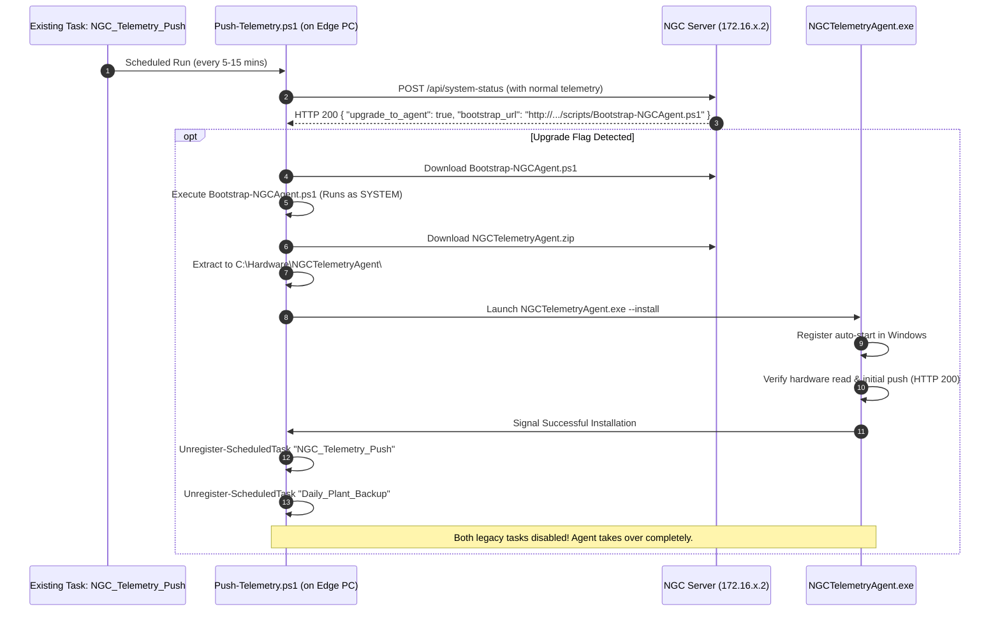

# NGC Edge Telemetry Agent - Architecture & Migration Plan
## Shifting `Push-Telemetry.ps1` & `DailyBackup.ps1` to a Unified Industrial Windows Agent

---

## 1. Executive Summary & Problem Statement

### 1.1 Background
The NGC Dashboard monitors optical inspection edge PCs across multiple manufacturing facilities (Plants 7, 8, and 9 with lines 73–104). Currently, every inspection machine in the plants runs **two separate Windows Scheduled Tasks**:
1. **`NGC_Telemetry_Push`**: Executes `Push-Telemetry.ps1` periodically (every 5–15 minutes) to gather hardware vitals, AI defect configurations, and software versions, pushing them to the plant dashboard server via `POST /api/system-status`.
2. **`Daily_Plant_Backup`**: Executes `scripts\DailyBackup.ps1` daily to compress inspection configurations, models, and system binaries, uploading them over SFTP to `172.16.207.14:22`.

### 1.2 Limitations of the Legacy Two-Script Setup
1. **Double Task Scheduler Overhead**: Two separate PowerShell processes running under `NT AUTHORITY\SYSTEM` introduce redundant process invocations, periodic CPU/disk contention, and risk frame drops on 24/7 camera inspection lines.
2. **Third-Party Fragility**: `Push-Telemetry.ps1` depends on downloading, unzipping, and polling registry keys from `HWiNFO64.exe` (`HKCU:\Software\HWiNFO64\VSB`), which can stall or break across Windows updates.
3. **No Centralized Backup Visibility**: `DailyBackup.ps1` outputs only to a local text log (`C:\Backup\BackupLog.txt`). Plant engineers and dashboard operators cannot see on the web interface whether edge backups succeeded, what the archive size was, or if an SFTP connection failed.
4. **Maintenance Nightmare**: Updating PowerShell scripts across 50+ edge machines requires manual intervention or error-prone file copying.

### 1.3 Key Objectives & User Concerns Addressed

#### Concern 1: "Do I need to deploy NGCTelemetryAgent every PC 1-by-1?"
**Answer: Absolutely NOT.**
Edge PCs will **NOT** be touched individually. Because all 50+ edge PCs across Plants 7, 8, and 9 already execute `NGC_Telemetry_Push` under `NT AUTHORITY\SYSTEM`, we leverage this existing scheduled task to perform a **Zero-Touch Automated OTA Handover**:
- The server serves a lightweight bootstrap script (`Bootstrap-NGCAgent.ps1`).
- The existing scheduled task downloads `NGCTelemetryAgent.exe`, registers it, verifies healthy operation, and **automatically disables both legacy tasks (`NGC_Telemetry_Push` and `Daily_Plant_Backup`)**.
- Alternatively, administrators can run the server-side fleet orchestrator (`Deploy-AgentFleet.ps1`) from the plant server to push the binary to all edge IP addresses across the subnet in parallel.
- Once deployed, the agent's built-in **Self-Update Engine** (`GET /api/agent/version` + `force_update`) ensures all future updates happen over-the-air from the dashboard server without ever visiting edge PCs again.

#### Concern 2: "Add Daily_Plant_Backup function to this agent"
**Solution**: The agent natively integrates the full `Daily_Plant_Backup` routine:
- Schedules automated daily archives at off-peak hours (default 02:00 AM or configurable).
- Employs **E-Core / Idle CPU Priority Throttling** (Priority `Idle`, Affinity core 0) so compression never steals cycles from live AI vision models (`Accusys HAIVIs`).
- Safely stages `C:\Accusys` (excluding `HAIVIs\log`), `C:\Hardware`, `C:\Program1`, and `C:\inetpub\wwwroot\NGCDashboard`.
- Automatically uploads archives over SFTP to `172.16.207.14:22` (`/BACKUP/Plant_{Plant}/{Line}{TierPrefix}.zip`).
- **Pushes live backup status to the NGC Dashboard**: Telemetry packets include `LastBackupTime`, `BackupStatus`, `BackupSizeMB`, and `DurationSeconds`, giving full fleet-wide backup visibility on the web dashboard.
- Provides a manual "Run Backup Now" button in the System Tray and allows remote backup triggers from the server.

---

## 2. Technology Stack & Process Architecture

### 2.1 Technology Stack
- **Framework**: .NET 8 LTS / .NET 9 LTS (C#).
- **Format**: Single-File Self-Contained Executable (`NGCTelemetryAgent.exe`, ~20 MB). Requires no .NET Runtime or SDK installation on edge PCs.
- **Hardware Abstraction**: Embedded `LibreHardwareMonitorLib` (zero external process overhead; direct MSR thermals and GPU metrics).
- **Storage SMART Subsystem**: Direct Win32 `DeviceIoControl` NVMe/SATA IOCTLs (spare %, wear %, bad sector counters) with embedded `smartctl.exe` fallback.
- **SFTP & Compression**: Native `SSH.NET` / WinSCP integration with `System.IO.Compression` throttled to low CPU priority.
- **UI**: Lightweight Windows Forms `NotifyIcon` System Tray + Flyout Dashboard + Settings Dialog.

### 2.2 Unified Process Model

```
+-----------------------------------------------------------------------------------+
|                              Windows Edge Inspection PC                           |
|                                                                                   |
|  +-----------------------------------------------------------------------------+  |
|  |                NGC Telemetry Agent (System Tray / Background Worker)        |  |
|  |                                                                             |  |
|  |  * Modern Tray Icon (Green = OK, Yellow = Warning, Red = Error)             |  |
|  |  * Flyout Dashboard (Live Temps, SSD Wear %, Bad Sectors, Backup Status)    |  |
|  |  * Settings Dialog (Server IP, Push Interval, Backup Schedule, SFTP Config) |  |
|  |  * Action Triggers: [ Force Telemetry Push ]  [ Run Daily Backup Now ]      |  |
|  +-----------------------------------------------------------------------------+  |
|             |                                                  |                  |
|             v                                                  v                  |
|  +-----------------------+                         +---------------------------+  |
|  | Telemetry Dispatcher  |                         | Daily Backup Subsystem    |  |
|  | * 5-min polling loop  |                         | * 02:00 AM Daily Trigger  |  |
|  | * NVMe/SATA SMART     |                         | * Robocopy staging        |  |
|  | * CPU/GPU thermals    |                         | * E-Core / Idle throttled |  |
|  | * HAIVIs/DIMR configs |                         | * SFTP to 172.16.207.14   |  |
|  +-----------------------+                         +---------------------------+  |
|             |                                                  |                  |
|             |  Telemetry Packet + Backup Status (HTTP POST)    |                  |
|             +--------------------------------------------------+                  |
|                                        |                                          |
+----------------------------------------|------------------------------------------+
                                         v
+-----------------------------------------------------------------------------------+
|                               NGC Dashboard Server (Laravel)                      |
|                                                                                   |
|  * POST /api/system-status (Stores vitals, SSD health, and backup audit metrics)  |
|  * GET  /api/agent/version  (Returns latest agent release & force_update flag)    |
|  * GET  /api/agent/download/{version} (Serves release package zip)                |
|  * POST /api/agent/update-status (Audit trail for fleet rollouts)                 |
+-----------------------------------------------------------------------------------+
```

---

## 3. PC Health & 24/7 Failsafe Monitoring Specifications

Industrial optical inspection machines run continuous 24/7 production shifts. Hardware metrics are captured natively in-process without spawning shell commands:

### 3.1 Storage Health & Bad Sector Detection
| Metric | Source | Warning Threshold | Critical Threshold | Purpose |
| :--- | :--- | :--- | :--- | :--- |
| **SSD Wear (Percentage Used)** | NVMe SMART log | ≥ 80% | ≥ 95% | Prevents drive write exhaustion |
| **Available Spare %** | NVMe SMART log | < 20% | < 10% | Factory spare NAND blocks depleted |
| **Media & Data Integrity Errors** | NVMe SMART log | > 0 | > 10 | Unrecovered read/write errors |
| **Reallocated Sector Count** | SATA SMART ID `05h` | > 0 | > 5 | Physical bad sectors remapped |
| **Current Pending Sector Count** | SATA SMART ID `C5h` | > 0 | > 1 | Unstable sectors waiting for remap |
| **Offline Uncorrectable Sectors**| SATA SMART ID `C6h` | > 0 | > 1 | Permanent data corruption indicator |
| **SSD Controller Temperature** | NVMe SMART | ≥ 65°C | ≥ 75°C | Thermal throttling / shutdown |
| **Free Volume Space (C: & D:)** | `DriveInfo` API | < 15% | < 5% or < 10 GB | Prevents disk full crashes |

### 3.2 CPU & Core Thermal Throttling
- **CPU Package & Core Temps**: Read via MSR registers. Alert at > 80°C; Critical at > 90°C.
- **Core Thermal Throttling Active**: Boolean flag detecting clock suppression to prevent frame drops.
- **CPU Load %**: Monitors total system utilization to identify runaway processes.

### 3.3 GPU Thermals & Power (AI Defect Acceleration)
- **GPU Core & Hotspot Temps**: Queried natively via `nvml.dll` P/Invoke or embedded `nvidia-smi`.
- **GPU Power (Watts) & Clock (MHz)**: Detects GPU performance drops below P0/P2 state.
- **GPU VRAM Utilization**: Used MB vs Total MB to detect memory leaks in Accusys models (`Post`, `NoGlove`, `Pre`, `GSS Defect`).

### 3.4 Inspection Data Parity
- **Identity XML**: `C:\Hardware\PC_Info.xml` (`P_str`, `L_str`, `T1_str`, `T2_str`).
- **Vision Model Config**: `C:\Accusys\HAIVIs\appsettings.json` (fallback `C:\Accusys\vmaimodel.txt`).
- **Software Versions**: `Accusys_MiddleWare.exe`, `DIMR_Engine.exe`, `IOC.bas`, `*.solw`.

---

## 4. Integrated Daily Plant Backup Subsystem

The agent integrates the full functionality of `scripts\DailyBackup.ps1` to eliminate the separate `Daily_Plant_Backup` Task Scheduler job while adding live telemetry reporting and manual trigger capabilities.

### 4.1 Backup Specifications & Source Paths
| Parameter | Configuration | Details |
| :--- | :--- | :--- |
| **Schedule** | Daily at `02:00:00` (Configurable) | Executes during shift handover / low line activity |
| **Identity Source** | `C:\Hardware\PC_Info.xml` | Extracts Plant (`P_str`), Line (`L_str`), and Tier (`T1_str`) |
| **Target Zip Name** | `{Line}{TierPrefix}.zip` | Example: Line `93`, Tier `L` -> `93L.zip` |
| **SFTP Target Server** | `172.16.207.14:22` | User: `svc_otsftp`, Pass: `z#&A2#@VEAq&krt` |
| **SFTP Remote Folder** | `/BACKUP/Plant_{Plant}/` | Auto-creates directory if not present on SFTP |
| **Local Staging Path** | `C:\Backup\Staging_{Line}\` | Temporary working folder, purged after zip creation |
| **Local Backup Root** | `C:\Backup\` | Holds temporary `{Line}{TierPrefix}.zip` during transfer |

### 4.2 Staged Directories & Exclusion Rules
1. **`C:\Accusys`**:
   - Robocopy staging: `/E /XD "C:\Accusys\HAIVIs\log" /R:0 /W:0`
   - **Crucial Exclusion**: Excludes the massive `HAIVIs\log` directory (saves 10–30 GB of redundant image logs per machine).
2. **`C:\Hardware`**: Backs up configuration XMLs and hardware profiles.
3. **`C:\Program1`**: Backs up line control software and PLC interfaces.
4. **`C:\inetpub\wwwroot\NGCDashboard`**: Optional; backed up if the host PC is a plant server.

### 4.3 E-Core & Low CPU Priority Throttling
In 24/7 manufacturing plants, zip compression can consume 100% CPU on all cores, causing camera frame acquisition to lag. The agent enforces strict hardware throttling during compression:
```csharp
// Pin compression worker to single core (Core 0 / E-Core) and Idle priority
Process.GetCurrentProcess().PriorityClass = ProcessPriorityClass.Idle;
Process.GetCurrentProcess().ProcessorAffinity = (IntPtr)1; // Single core
```
Once compression finishes, the process automatically restores normal priority and full processor affinity.

### 4.4 Live Telemetry Reporting
Unlike `DailyBackup.ps1` which logged silently to a text file, `NGCTelemetryAgent` captures backup metrics and sends them in every `POST /api/system-status` payload:
```json
"Backup_Status": {
  "LastBackupTime": "2026-11-11 02:15:30",
  "Status": "SUCCESS",
  "ZipSizeMB": 420.5,
  "DurationSeconds": 142,
  "RemotePath": "/BACKUP/Plant_9/93L.zip",
  "ErrorMessage": null
}
```
The NGC Dashboard displays a **Backup Health Badge** for every machine:
- 🟢 **Backed Up**: Backup succeeded within the last 24 hours.
- 🟡 **Overdue**: Last backup occurred > 24 hours ago.
- 🔴 **Failed**: Last backup encountered an error (e.g., SFTP unreachable, disk full).

---

## 5. UI/UX Design & System Tray Experience

The agent runs unobtrusively in the Windows System Tray with touch-friendly controls for line operators and maintenance technicians.

### 5.1 System Tray Icon (`NotifyIcon`)
- **Icon States**:
  - 🟢 **Green**: Connected, telemetry pushing normally, hardware healthy, backup current.
  - 🟡 **Yellow**: Warning (high temp > 80°C, update available, backup overdue > 24h).
  - 🔴 **Red**: Critical (bad sectors > 0, thermal throttling, push failing, backup failed).
- **Context Menu**:
  - **Open Dashboard**: Opens live hardware flyout.
  - **Force Telemetry Push**: Triggers immediate sync with server.
  - **Run Daily Backup Now**: Triggers on-demand staging, compression, and SFTP upload.
  - **Check for Updates**: Contacts server for latest release.
  - **Settings**: Opens configuration modal.
  - **Exit**: Protected with confirmation dialog.

### 5.2 Settings Dialog
- **Server Connection**:
  - Auto-Detect Server (`172.16.x.2` / `192.168.100.243`) or Manual IP entry.
  - Test Connection button with latency check.
- **Telemetry Frequency**:
  - Interval options: `30s`, `1m`, `5m` (Default), `10m`, `15m`.
- **Daily Backup Settings**:
  - Scheduled time (Default: `02:00 AM`).
  - SFTP Server IP, Port, and User credentials.
  - Backup target directory preview (`/BACKUP/Plant_{P}/{L}{T}.zip`).
  - Staging directories list.
- **System Startup**:
  - Checkbox: "Start with Windows (Run on logon / System Task)".
  - Checkbox: "Start minimized to system tray".

---

## 6. Zero-Touch Fleet Deployment & Automated Handover Strategy

### 6.1 Addressing the Core Concern
> **"Do I need to deploy NGCTelemetryAgent every PC 1-by-1? If yes it will be so much troublesome."**

**No manual PC visits are required.** Because all edge PCs across Plants 7, 8, and 9 already execute the `NGC_Telemetry_Push` task scheduler job under `NT AUTHORITY\SYSTEM`, we provide two automated rollout mechanisms:

---

### Method A: Automated Over-the-Air (OTA) Handover via Existing Task Scheduler
In this zero-touch flow, the existing `NGC_Telemetry_Push` task acts as the delivery vehicle for its own successor:



#### Why This Works:
1. Every edge PC is already running `NGC_Telemetry_Push` as `NT AUTHORITY\SYSTEM`.
2. It already communicates with the plant server (`http://$ipAddress`).
3. The server can activate the upgrade fleet-wide or plant-by-plant by simply serving the bootstrap script.
4. The moment `NGCTelemetryAgent` verifies its first successful push, it disables the old scheduled tasks, leaving the system clean.

---

### Method B: Centralized Plant Server Fleet Orchestrator (`Deploy-AgentFleet.ps1`)
For instant, synchronous deployment across a plant without waiting for scheduled tasks:
- An administrator runs `scripts\Deploy-AgentFleet.ps1` directly from the Plant Dashboard Server (`172.16.x.2`).
- The script automatically queries the local SQLite/MySQL database (`telemetry_logs`) to extract the IP addresses of all reporting edge machines in that plant.
- In parallel (PowerShell background runspaces):
  1. Tests network connectivity to the edge PC.
  2. Copies the release package to `\\<PC-IP>\c$\Hardware\NGCTelemetryAgent\`.
  3. Uses PowerShell Remoting (`Invoke-Command`) or WMI/PsExec to execute `NGCTelemetryAgent.exe --install`.
  4. Automatically disables `NGC_Telemetry_Push` and `Daily_Plant_Backup` on the remote PC.
- Displays a live progress matrix showing which machines have successfully upgraded.

---

## 7. Software Self-Update Engine (In-Service Updates)

Once `NGCTelemetryAgent` is deployed on the edge PC, it **never needs manual intervention again**. All future updates are handled by its built-in Two-Stage Atomic Bootstrapper:

```
[Main Application Directory: C:\Hardware\NGCTelemetryAgent\]
├── NGCTelemetryAgent.exe      <-- Running application
├── LibreHardwareMonitor.dll
├── config.json               <-- Persisted settings (interval, IP, backup schedule)
├── updater.exe               <-- Tiny helper utility (~200 KB)
├── updates\                  <-- Staged download folder
└── backup\                   <-- Rollback snapshot (previous working version)
```

### 7.1 Remote Forced Updates (`force_update == true`)
1. Dashboard administrator uploads a new agent release (`v1.1.0`) on the web UI and sets `force_update = true`.
2. Edge agents discover the update via `GET /api/agent/version` or passive piggyback on `POST /api/system-status`.
3. The agent downloads the update package, verifies SHA-256 integrity, unpacks to `staging\`, and spawns `updater.exe`.
4. `updater.exe` waits for the main process to exit, swaps files, creates a backup snapshot, and launches the new version.
5. **Auto-Rollback Protection**: If the new version crashes or fails health check within 30 seconds, `updater.exe` automatically restores the backup snapshot, relaunches the previous version, and logs an incident to the server.

---

## 8. Server-Side (Laravel) Architecture & API Contracts

### 8.1 Database Migrations

#### Migration 1: Extend `telemetry_logs`
```php
Schema::table('telemetry_logs', function (Blueprint $table) {
    $table->string('agent_version')->nullable()->after('side');
    $table->bigInteger('system_uptime_seconds')->nullable()->after('gpu_clock');
    $table->string('app_uptime')->nullable()->after('system_uptime_seconds');
    
    // Backup tracking columns
    $table->timestamp('last_backup_at')->nullable()->after('app_uptime');
    $table->string('backup_status')->nullable()->after('last_backup_at'); // SUCCESS, FAILED, RUNNING
    $table->decimal('backup_size_mb', 8, 2)->nullable()->after('backup_status');
    $table->integer('backup_duration_seconds')->nullable()->after('backup_size_mb');
    $table->text('backup_error')->nullable()->after('backup_duration_seconds');
});
```

#### Migration 2: Extend `telemetry_ssd_logs`
```php
Schema::table('telemetry_ssd_logs', function (Blueprint $table) {
    $table->integer('available_spare_percent')->nullable()->after('percentage_used');
    $table->integer('reallocated_sectors')->nullable()->after('available_spare_percent');
    $table->integer('pending_sectors')->nullable()->after('reallocated_sectors');
    $table->integer('uncorrectable_errors')->nullable()->after('pending_sectors');
    $table->string('smart_health_status')->default('PASSED')->after('uncorrectable_errors');
});
```

#### Migration 3: Create `agent_releases` Table
```php
Schema::create('agent_releases', function (Blueprint $table) {
    $table->id();
    $table->string('version')->unique();
    $table->string('package_path');
    $table->string('sha256_hash');
    $table->boolean('force_update')->default(false);
    $table->string('min_supported_version')->default('1.0.0');
    $table->text('changelog')->nullable();
    $table->json('target_plants')->nullable(); // null for fleet-wide, or ["7", "8", "9"]
    $table->boolean('is_active')->default(true);
    $table->timestamps();
});
```

### 8.2 API Contracts

#### 1. Version Check: `GET /api/agent/version`
```json
{
  "has_update": true,
  "current_version": "1.0.0",
  "latest_version": "1.1.0",
  "download_url": "http://172.16.50.2/api/agent/download/1.1.0",
  "sha256": "4f53cda18c2baa0c0354bb5f9a3ecbe5ed12ab4d8e11ba873c2f11161202b945",
  "force_update": false,
  "changelog": "Added integrated daily backup engine and SATA bad sector detection.",
  "restart_delay_seconds": 15
}
```

#### 2. Telemetry Ingest: `POST /api/system-status`
```json
{
  "Plant": "9",
  "Line": "93",
  "Tier 1": "L",
  "Tier 2": "1",
  "Agent": {
    "Version": "1.0.0",
    "UptimeSeconds": 86400,
    "PushIntervalSeconds": 300
  },
  "Backup_Status": {
    "LastBackupTime": "2026-11-11 02:15:30",
    "Status": "SUCCESS",
    "ZipSizeMB": 420.5,
    "DurationSeconds": 142,
    "RemotePath": "/BACKUP/Plant_9/93L.zip",
    "ErrorMessage": null
  },
  "Version": {
    "solw": "Default.solw",
    "MiddleWare": "1.0.4.2",
    "DIMR": "12/08/2026",
    "IOC.bas": "10/05/2026"
  },
  "Config Model": {
    "SkuMode": "0",
    "Post": "model_post_v2.dl",
    "NoGlove": "model_noglove_v1.dl",
    "Pre": "model_pre_v3.dl",
    "GSS Defect": "model_gss_v4.dl"
  },
  "SSD_Status": [
    {
      "DiskModel": "Samsung SSD 980 PRO 1TB",
      "PhysicalDiskNumber": 0,
      "DriveLetter": "C:",
      "TotalSpaceGB": 931.5,
      "RemainingSpaceGB": 642.3,
      "TemperatureCelsius": 41,
      "PercentageUsed": 12,
      "AvailableSparePercent": 100,
      "ReallocatedSectors": 0,
      "PendingSectors": 0,
      "UncorrectableErrors": 0,
      "HealthStatus": "PASSED"
    }
  ],
  "PC Thermal": {
    "CPU Temp": "48",
    "CPU Thermal Throttle": "No",
    "CPU Load Percent": "14",
    "GPU Temp": "52",
    "GPU Power": "68",
    "GPU Clock": "1845",
    "GPU VRAM Used MB": "3200",
    "GPU VRAM Total MB": "8192"
  }
}
```

---

## 9. Implementation Roadmap & Phased Execution

```
+---------------------------------------------------------------------------------------+
|                                    PROJECT ROADMAP                                    |
|                                                                                       |
|  [Phase 1] Core C# Engine & Backup         [Phase 2] System Tray & Settings UI        |
|  * LibreHardwareMonitorLib integration     * WinForms NotifyIcon & Status Menu        |
|  * NVMe & SATA SMART Bad Sector readers    * Flyout Dashboard with live vitals        |
|  * Native Daily Backup subsystem           * Backup Now & Force Push actions          |
|  * SFTP upload & E-Core CPU throttling     * Local JSON config & connection tester    |
|                          |                                    |                       |
|                          +-----------------+------------------+                       |
|                                            |                                          |
|                                            v                                          |
|  [Phase 3] Server Telemetry & Update APIs  [Phase 4] Zero-Touch Deployment & Updater  |
|  * Laravel DB migrations for backup/update * Bootstrap-NGCAgent.ps1 for OTA handover  |
|  * DashboardController payload ingestion   * Deploy-AgentFleet.ps1 server orchestrator|
|  * GET /api/agent/version & download       * Atomic bootstrapper (updater.exe)        |
|  * Backup Health Badges in Web UI          * Automated Task Scheduler retirement      |
|                                            |                                          |
|                                            v                                          |
|  [Phase 5] Fleet Pilot & Legacy Retirement                                            |
|  * Deploy on Plant 9 Line 93 (Left & Right) via OTA bootstrap                         |
|  * Verify telemetry ingestion, hardware vitals, and daily SFTP backup                 |
|  * Confirm automatic retirement of NGC_Telemetry_Push and Daily_Plant_Backup          |
|  * Roll out fleet-wide across Plants 7, 8, and 9                                      |
+---------------------------------------------------------------------------------------+
```

---

## 10. Summary Checklist for Engineers

- [x] **Zero Manual PC Visits**: Initial rollout automated via existing `NGC_Telemetry_Push` task or server-side `Deploy-AgentFleet.ps1`.
- [x] **Task Consolidation**: Single agent replaces both `NGC_Telemetry_Push` and `Daily_Plant_Backup`.
- [x] **No Frame Drops**: Compression and monitoring run throttled to Idle priority and single E-core.
- [x] **Visible Backup Health**: Backup status reported to the web dashboard, ending silent failures.
- [x] **Self-Healing Updates**: In-service atomic updater with automatic rollback ensures 0% risk of orphaned machines.
