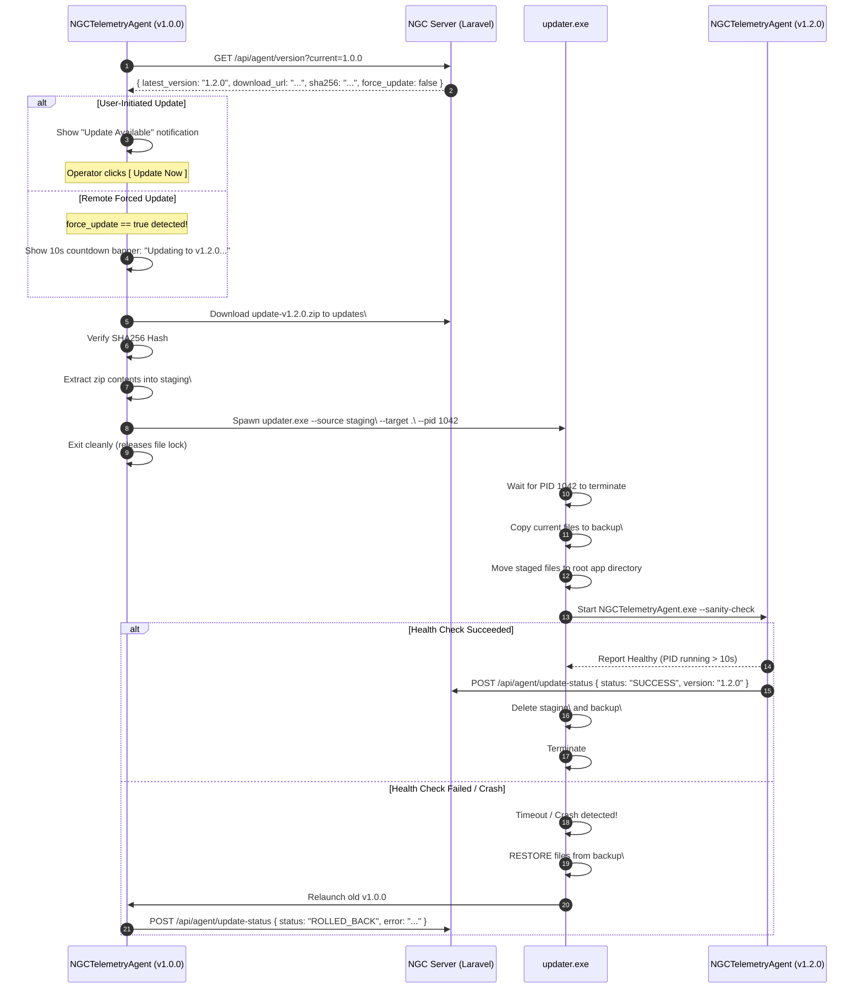

# NGC Edge Telemetry Agent - Architecture & Migration Plan
## Shifting `Push-Telemetry.ps1` to a Lightweight Industrial Windows App

---

## 1. Executive Summary & Problem Statement

### 1.1 Background
The NGC Dashboard currently monitors optical inspection edge PCs across multiple manufacturing plants (e.g., Plant 7, 8, and 9 with lines 73–104). Currently, hardware vitals, AI defect configurations, and software versions are gathered via a PowerShell script (`Push-Telemetry.ps1`) executed periodically via Windows Task Scheduler.

### 1.2 Limitations of the Script-Based Collector
1. **Process & Shell Overhead**: Spawning `powershell.exe`, `smartctl.exe`, `reg.exe`, and `nvidia-smi.exe` every 5 minutes causes periodic CPU/disk spikes, risks brief command prompt window flashes, and produces memory fragmentation on 24/7 inspection machines.
2. **Third-Party Dependency Fragility**: `Push-Telemetry.ps1` downloads, unzips, and runs `HWiNFO64.exe` in the background, writing sensor data to registry keys (`HKCU:\Software\HWiNFO64\VSB`). This is fragile, requires registry polling loops, and can break across Windows updates or anti-virus scans.
3. **Zero Operator Visibility**: Operators and technicians on the line cannot easily see if telemetry is healthy, whether data is reaching the server, or what error occurred when a push fails.
4. **Hardcoded Settings**: Changing push intervals or server endpoints requires editing `.ps1` code or altering Task Scheduler triggers on every individual edge PC.
5. **Lack of In-Service Auto-Updating**: Updating PowerShell scripts across 50+ edge machines requires manual file copying or custom deployment scripts.

### 1.3 Objectives
- Build **NGC Telemetry Agent**: a lightweight, native, self-contained Windows application (system tray + background service).
- Native 24/7 hardware monitoring (NVMe/SATA SSD wear, bad sectors, CPU/GPU thermals, RAM, and process health) **without** third-party background software like HWiNFO64.
- Embedded Settings page allowing on-site engineers to adjust the push interval, server endpoint, and alert thresholds.
- Robust two-stage self-update engine supporting:
  - **User-Initiated Updates**: Checking updates via HTTP `GET`, showing release notes, and updating upon operator confirmation ("Update Now").
  - **Remote Forced Updates**: Server-driven `force_update` flag for fleet-wide automated patching without on-site human intervention.
  - **Atomic Swapping & Automatic Rollback**: In-service file swapping with failure detection and rollback protection.

---

## 2. Technology Stack & Architecture

### 2.1 Technology Evaluation

| Criteria | C# / .NET 8 or 9 (WinForms / WPF Native AOT) | Go (Wails / Systray) | Rust (Tauri / Slint) | Electron / WebView2 |
| :--- | :--- | :--- | :--- | :--- |
| **Footprint (RAM)** | **~25 MB** (Very Low) | ~30 MB (Very Low) | ~25 MB (Very Low) | 180–300 MB (High ❌) |
| **Binary Size** | **~20 MB** (Single-file self-contained) | ~15 MB | ~15 MB | 80–120 MB |
| **Hardware / SMART Access** | **Native P/Invoke, WMI, LibreHardwareMonitorLib** | Requires CGo / external DLLs | Requires unsafe winapi bindings | Requires external CLI spawning |
| **System Tray & GUI** | **Native WinForms `NotifyIcon` / WPF** | Basic systray | Web GUI | Web GUI (High overhead) |
| **24/7 Industrial Fitness** | **High** (Standard for Windows IoT / LTSC) | Medium | High | Low (Resource contention with AI models) |

### 2.2 Selected Architecture: .NET 8/9 LTS Standalone Agent
- **Framework**: .NET 8 LTS or .NET 9 (C#).
- **Deployment Format**: Single-File, Self-Contained Executable (`NGCTelemetryAgent.exe`). No .NET Runtime or SDK installation required on the edge PCs.
- **Hardware Abstraction**: Embedded **`LibreHardwareMonitorLib`** (open-source industrial-grade library) to query CPU temperatures, core thermal throttling, and GPU metrics in-process with 0% external process overhead.
- **Storage Subsystem**: Direct Win32 `DeviceIoControl` / NVMe SMART IOCTLs for SSD wear, temperature, and bad sector counters (with fallback to an embedded, statically bundled `smartctl.exe`).

### 2.3 Process Model: Dual-Layer Architecture

```
+-----------------------------------------------------------------------------------+
|                              Windows Edge Inspection PC                           |
|                                                                                   |
|  +-----------------------------------------------------------------------------+  |
|  |                     NGC Telemetry Agent (Foreground / Tray)                 |  |
|  |                                                                             |  |
|  |  * Modern System Tray Icon (Green = OK, Yellow = Warning, Red = Error)     |  |
|  |  * Dashboard Flyout (Live CPU/GPU temps, SSD wear %, bad sectors, versions) |  |
|  |  * Settings Modal (Push Interval, Server URL, Test Connection, Startup)    |  |
|  |  * Software Update Modal ("Update Available: v1.2.0" -> [Update Now])       |  |
|  +-----------------------------------------------------------------------------+  |
|                                        |                                          |
|                          Internal Polling & Dispatch Loop                         |
|                                        v                                          |
|  +-----------------------------------------------------------------------------+  |
|  |                     Native Hardware Telemetry Engine                        |  |
|  |                                                                             |  |
|  |  * Storage Health: NVMe Wear %, Spare %, Bad Sectors (Reallocated/Pending)  |  |
|  |  * Thermals: CPU Package Temp, Core Throttling, GPU Temp, Power, Clock     |  |
|  |  * Inspection Audits: Accusys HAIVIs models, MiddleWare, DIMR, IOC, solw    |  |
|  |  * LabVIEW Identity: C:\Hardware\PC_Info.xml (Plant, Line, Tier 1/2)        |  |
|  +-----------------------------------------------------------------------------+  |
|                                        |                                          |
|             HTTP POST (Payload)        |        HTTP GET (Version Check)          |
|                      |                 |                   |                      |
+----------------------|-----------------|-------------------|----------------------+
                       |                 |                   |
                       v                 |                   v
+-----------------------------------------------------------------------------------+
|                               NGC Dashboard Server (Laravel)                      |
|                                                                                   |
|  * POST /api/system-status (Stores metrics in SQLite & Cache)                     |
|  * GET  /api/agent/version  (Returns latest agent release & force_update flag)    |
|  * GET  /api/agent/download/{version} (Serves release package zip)                |
|  * POST /api/agent/update-status (Audit trail for fleet rollouts)                 |
+-----------------------------------------------------------------------------------+
```

---

## 3. PC Health & 24/7 Failsafe Monitoring Specifications

To ensure edge optical inspection machines run continuous 24/7 shifts without unexpected halts, the agent will monitor critical hardware components and detect failure signals before catastrophic hardware crash.

### 3.1 Storage Health & Bad Sector Detection
Industrial SSDs in 24/7 optical inspection environments experience massive daily read/write cycles (saving camera frames and inference logs).

| Metric | Source | Warning Threshold | Critical Threshold | Purpose |
| :--- | :--- | :--- | :--- | :--- |
| **SSD Wear (Percentage Used)** | NVMe SMART log | ≥ 80% | ≥ 95% | Prevents drive write exhaustion |
| **Available Spare %** | NVMe SMART log | < 20% | < 10% | Factory spare NAND blocks depleted |
| **Media & Data Integrity Errors** | NVMe SMART log | > 0 | > 10 | Unrecovered read/write errors |
| **Reallocated Sector Count** | SATA SMART ID `05h` | > 0 | > 5 | Physical bad sectors remapped |
| **Current Pending Sector Count** | SATA SMART ID `C5h` | > 0 | > 1 | Unstable sectors waiting for remap |
| **Offline Uncorrectable Sectors** | SATA SMART ID `C6h` | > 0 | > 1 | Permanent data corruption indicator |
| **SSD Controller Temperature** | NVMe SMART | ≥ 65°C | ≥ 75°C | Thermal throttling / thermal shutdown |
| **Free Volume Space (C: & D:)** | `DriveInfo` API | < 15% | < 5% or < 10 GB | Disk full crashes inspection software |

### 3.2 CPU & Core Thermal Throttling
- **CPU Package & Core Temperatures**: Monitored via MSR (Model Specific Registers) through `LibreHardwareMonitorLib`. Alert at > 80°C; Critical at > 90°C.
- **Core Thermal Throttling Active**: Boolean flag indicating CPU is suppressing clock frequency to prevent melting. In optical inspection, thermal throttling causes frame drops and line lag.
- **CPU Total Utilization**: Average load % over the interval. Identifies runaway threads or deadlocks.

### 3.3 GPU Thermals & Power (AI Inference Accelerator)
- **GPU Core & Hotspot Temperature**: Queries via native NVIDIA Management Library (`nvml.dll` via P/Invoke) or embedded `nvidia-smi`.
- **GPU Power Draw (Watts) & Clock Speed (MHz)**: Detects whether the GPU dropped from P0/P2 high-performance state to a low power state.
- **GPU VRAM Utilization**: Used MB vs. Total MB. Prevents out-of-memory (OOM) crashes in Accusys AI defect models (`Post`, `NoGlove`, `Pre`, `GSS Defect`).

### 3.4 System Reliability & Process Watchdog
- **System Uptime & Reboot Detection**: Tracks system uptime and inspects Windows Event Log (System Event ID 41 / 1001) to notify the server of unexpected power cuts or BSODs.
- **Physical Memory Pressure**: Free RAM, Total RAM, Commit Charge %.
- **Inspection Software Process Alive Checks**:
  - `Accusys_MiddleWare.exe`
  - `DIMR_Engine.exe`
  - Camera acquisition services

### 3.5 Existing Inspection Data Parity
The agent preserves 100% compatibility with existing data ingested from `Push-Telemetry.ps1`:
- **Identity XML**: `C:\Hardware\PC_Info.xml` (Plant, Line, Tier 1, Tier 2).
- **Vision Model Config**: `C:\Accusys\HAIVIs\appsettings.json` (fallback `C:\Accusys\vmaimodel.txt`).
- **Software File Versions & Mod Dates**:
  - `Accusys_MiddleWare.exe` (FileVersion)
  - `DIMR_Engine.exe` (LastWriteTime)
  - `IOC.bas` (LastWriteTime)
  - `*.solw` (Count and filename)

---

## 4. UI/UX Design & Settings Page

The application is built to run silently in the background while providing an intuitive, touch-friendly UI when needed by on-site technicians.

### 4.1 System Tray Icon (`NotifyIcon`)
- **Icon Visual Indicator**:
  - 🟢 **Green**: Connected, telemetry pushing normally, hardware healthy.
  - 🟡 **Yellow**: Minor warning (e.g., high temperature, update available, high SSD wear).
  - 🔴 **Red**: Critical warning (bad sectors detected, thermal throttle, push failing).
- **Tray Context Menu**:
  - **Open Dashboard**: Shows hardware vitals and push status.
  - **Push Now**: Triggers an immediate telemetry sync.
  - **Check for Updates**: Contacts server for latest agent release.
  - **Settings**: Opens configuration page.
  - **Exit**: Protected with password prompt (or confirmation) to prevent accidental closure on production lines.

### 4.2 Dashboard View (Main Window)
- **Header**: Plant Number, Line Number, Side (Left/Right), Local IP, Agent Version.
- **Vitals Matrix**:
  - CPU Package: `48°C` | Core Throttling: `No` | CPU Usage: `12%`
  - GPU: `52°C` | `65 W` | `1850 MHz` | VRAM: `3.4 / 8.0 GB`
  - Drives:
    - `C:\`: `78.5 GB free` (18% used) | Wear: `8%` | Temp: `42°C` | Bad Sectors: `0`
    - `D:\`: `320.1 GB free` (54% used) | Wear: `14%` | Temp: `44°C` | Bad Sectors: `0`
- **Telemetry Sync Status**:
  - Last Push: `Today 01:15:32 (HTTP 200 OK)`
  - Next Push in: `04:28` (Progress bar)
  - Button: `[ Force Push Now ]`

### 4.3 Settings Page
- **Telemetry Frequency**:
  - Push Interval Selector: `[ 30 seconds | 1 minute | 5 minutes (Default) | 10 minutes | 15 minutes ]`
  - Accelerate on Warning: Checkbox (`"Temporarily push every 30s if critical thermal or bad sectors detected"`).
- **Server Connection**:
  - Mode: `Auto-Detect Plant Server (172.16.x.2 / 192.168.100.243)` OR `Manual Endpoint`.
  - Server URL input: `http://172.16.50.2/api/system-status`
  - Test Connection Button: Checks connectivity and displays latency (ms).
- **Local Cache & Offline Resiliency**:
  - Store unsent telemetry locally if server is offline (buffer up to 24 hours).
  - Automatically flush backlogged telemetry when connection is restored.
- **System Startup**:
  - Checkbox: `"Start automatically with Windows (Startup Registry / Task Scheduler)"`.
  - Checkbox: `"Start minimized to System Tray"`.
  - Checkbox: `"Run as elevated Administrator"`.

---

## 5. Software Update Engine: Architecture & "Better Methods"

### 5.1 The Challenge of Updating Windows Desktop Apps
On Windows, an executable or DLL file cannot be overwritten while it is executing (`ERROR_SHARING_VIOLATION`). If an application simply downloads a new `.exe` and attempts to replace itself, the operation will fail. Furthermore, in 24/7 manufacturing plants, an interrupted update (power glitch or process crash) could leave the edge PC without any monitoring agent.

### 5.2 Better Method: Two-Stage Atomic Bootstrapper with Auto-Rollback

Instead of simple file copying, we employ an industrial-grade **Two-Stage Atomic Bootstrapper** pattern:

```
[Main Application Directory: C:\Hardware\NGCTelemetryAgent\]
├── NGCTelemetryAgent.exe      <-- Running application
├── LibreHardwareMonitor.dll
├── config.json               <-- Persisted settings (interval, IP, etc.)
├── updater.exe               <-- Tiny helper utility (~200 KB)
│
├── updates\                  <-- Staged download folder
│   └── update-v1.2.0.zip
│
└── backup\                   <-- Rollback snapshot (v1.0.0)
    └── NGCTelemetryAgent.exe
```

#### Step-by-Step Execution Lifecycle:



### 5.3 Update Modes Detailed

#### Mode 1: User-Initiated Update ("Update Now")
1. The agent checks `GET /api/agent/version` periodically (e.g. every 6 hours or upon opening the Settings/About tab).
2. If `latest_version > current_version` and `force_update == false`:
   - System tray shows an info balloon: *"NGC Telemetry Agent v1.2.0 available"*.
   - Settings window displays release highlights, changelog, and a prominent **`[ Update Now ]`** button.
   - When the user clicks **`[ Update Now ]`**, the download and atomic upgrade sequence begins.

#### Mode 2: Remote Server-Side Forced Update (`force_update == true`)
1. On critical bug fixes or protocol updates, an administrator in the NGC Dashboard toggles `force_update = true` for target plants or fleet-wide.
2. The agent discovers this flag either through:
   - The dedicated `GET /api/agent/version` endpoint.
   - **Passive Piggyback**: The standard `POST /api/system-status` response includes `{"force_update": true, "latest_version": "1.2.0"}`.
3. Upon receiving the forced flag:
   - The agent automatically initiates download and hash verification in the background.
   - If a monitor is active, a non-intrusive 15-second toast alert appears: *"Mandatory System Update: Telemetry Agent will update to v1.2.0 in 15 seconds."*
   - Once the timer expires, the agent hands off execution to `updater.exe` and updates automatically.

#### Mode 3: Automatic Rollback & Fault Tolerance
- If the new binary crashes immediately upon launch (e.g. missing OS DLL or incompatibilities), `updater.exe` detects that the new process exited with a non-zero code or failed to signal readiness within 30 seconds.
- `updater.exe` instantly restores the previous working version from `backup\`, starts it back up, and submits an incident report to the NGC Dashboard server.
- Telemetry reporting is preserved with zero permanent downtime.

---

## 6. Server-Side (Laravel) Architecture & API Contracts

To support the Windows app, the existing Laravel backend requires three lightweight endpoints and minor schema extensions.

### 6.1 Database Schema Enhancements

#### Migration 1: Extend `telemetry_logs`
```php
Schema::table('telemetry_logs', function (Blueprint $table) {
    $table->string('agent_version')->nullable()->after('side');
    $table->bigInteger('system_uptime_seconds')->nullable()->after('gpu_clock');
    $table->string('app_uptime')->nullable()->after('system_uptime_seconds');
});
```

#### Migration 2: Extend `telemetry_ssd_logs` (Bad Sectors & Health Details)
```php
Schema::table('telemetry_ssd_logs', function (Blueprint $table) {
    $table->integer('available_spare_percent')->nullable()->after('percentage_used');
    $table->integer('reallocated_sectors')->nullable()->after('available_spare_percent');
    $table->integer('pending_sectors')->nullable()->after('reallocated_sectors');
    $table->integer('uncorrectable_errors')->nullable()->after('pending_sectors');
    $table->string('smart_health_status')->default('PASSED')->after('uncorrectable_errors');
});
```

#### Migration 3: Create `agent_releases` Table
```php
Schema::create('agent_releases', function (Blueprint $table) {
    $table->id();
    $table->string('version')->unique(); // e.g. "1.2.0"
    $table->string('package_path');      // e.g. "releases/NGC-Agent-1.2.0.zip"
    $table->string('sha256_hash');
    $table->boolean('force_update')->default(false);
    $table->string('min_supported_version')->default('1.0.0');
    $table->text('changelog')->nullable();
    $table->json('target_plants')->nullable(); // null for fleet-wide, or ["7", "8", "9"]
    $table->boolean('is_active')->default(true);
    $table->timestamps();
});
```

### 6.2 API Contracts

#### 1. Version Check Endpoint
- **Method**: `GET /api/agent/version`
- **Query Parameters**:
  - `current_version`: `string` (e.g. `1.0.0`)
  - `plant`: `string` (e.g. `9`)
  - `line`: `string` (e.g. `93`)
  - `side`: `string` (e.g. `L`)
- **Response `(200 OK)`**:
```json
{
  "has_update": true,
  "current_version": "1.0.0",
  "latest_version": "1.2.0",
  "release_date": "2026-11-15T08:00:00Z",
  "download_url": "http://172.16.50.2/api/agent/download/1.2.0",
  "sha256": "4f53cda18c2baa0c0354bb5f9a3ecbe5ed12ab4d8e11ba873c2f11161202b945",
  "force_update": false,
  "min_supported_version": "1.0.0",
  "changelog": "Added SATA bad sector detection, native GPU VRAM tracking, and configurable push interval.",
  "restart_delay_seconds": 15
}
```

#### 2. Package Download Endpoint
- **Method**: `GET /api/agent/download/{version}`
- **Response**: Streams binary zip file (`NGC-Agent-{version}.zip`) with `Content-Type: application/zip`.

#### 3. Update Audit Status Endpoint
- **Method**: `POST /api/agent/update-status`
- **Payload**:
```json
{
  "plant": "9",
  "line": "93",
  "side": "L",
  "previous_version": "1.0.0",
  "target_version": "1.2.0",
  "status": "SUCCESS", // or "ROLLED_BACK", "DOWNLOAD_FAILED"
  "error_message": null,
  "timestamp": "2026-11-15T08:05:22Z"
}
```

#### 4. Updated Telemetry Payload (`POST /api/system-status`)
The app will continue to push to `/api/system-status` with enriched fields:
```json
{
  "Plant": "9",
  "Line": "93",
  "Tier 1": "L1",
  "Tier 2": "L2",
  "Agent": {
    "Version": "1.2.0",
    "UptimeSeconds": 86400,
    "PushIntervalSeconds": 300
  },
  "Version": {
    "solw": "Default.solw",
    "MiddleWare": "1.0.4.2",
    "DIMR": "12/08/2026",
    "IOC.bas": "10/05/2026"
  },
  "Config Model": {
    "SkuMode": "0",
    "Post": "model_post_v2.dl",
    "NoGlove": "model_noglove_v1.dl",
    "Pre": "model_pre_v3.dl",
    "GSS Defect": "model_gss_v4.dl",
    "Post Black": "not set",
    "NoGlove Black": "not set",
    "Pre Black": "not set",
    "GSS Black": "not set",
    "GSS Machine": "not set"
  },
  "SSD_Status": [
    {
      "DiskModel": "Samsung SSD 980 PRO 1TB",
      "PhysicalDiskNumber": 0,
      "DriveLetter": "C:",
      "TotalSpaceGB": 931.5,
      "RemainingSpaceGB": 642.3,
      "TemperatureCelsius": 41,
      "PercentageUsed": 12,
      "AvailableSparePercent": 100,
      "ReallocatedSectors": 0,
      "PendingSectors": 0,
      "UncorrectableErrors": 0,
      "HealthStatus": "PASSED"
    }
  ],
  "PC Thermal": {
    "CPU Temp": "48",
    "CPU Thermal Throttle": "No",
    "CPU Load Percent": "14",
    "GPU Temp": "52",
    "GPU Power": "68",
    "GPU Clock": "1845",
    "GPU VRAM Used MB": "3200",
    "GPU VRAM Total MB": "8192"
  }
}
```

---

## 7. Implementation Roadmap & Phased Execution

```
+---------------------------------------------------------------------------------------+
|                                    PROJECT ROADMAP                                    |
|                                                                                       |
|  [Phase 1] Core C# Telemetry Engine        [Phase 2] System Tray & Settings UI        |
|  * LibreHardwareMonitorLib integration     * WinForms NotifyIcon & Status Menu        |
|  * NVMe & SATA SMART Bad Sector readers    * Modern Settings Window (Push interval)   |
|  * LabVIEW XML & Accusys config parser     * Local JSON config & connection tester    |
|                          |                                    |                       |
|                          +-----------------+------------------+                       |
|                                            |                                          |
|                                            v                                          |
|  [Phase 3] Server Update APIs              [Phase 4] Atomic Bootstrapper              |
|  * Laravel DB migrations & models          * updater.exe helper utility               |
|  * GET /api/agent/version                  * SHA-256 verification & extraction        |
|  * Admin Agent Release Manager in Web UI   * Auto-Rollback on startup failure         |
|                                            |                                          |
|                                            v                                          |
|  [Phase 5] Fleet Pilot & Script Retirement                                            |
|  * Pilot deployment on Plant 9 (Line 93-L)                                            |
|  * Verify telemetry ingestion & alerts                                                |
|  * Decommission Push-Telemetry.ps1 Task Scheduler jobs                                |
+---------------------------------------------------------------------------------------+
```

### Phase 1: Core C# Telemetry Engine
- [ ] Initialize .NET 8/9 C# solution with `LibreHardwareMonitorLib`.
- [ ] Build `HardwareMonitorService` to query CPU Package temperature, core throttle flags, and GPU metrics without external executables.
- [ ] Build `StorageHealthService` supporting SMART attributes (reallocated sectors, pending sectors, NVMe wear %, available spare %).
- [ ] Build `InspectionConfigReader` to extract `C:\Hardware\PC_Info.xml`, `appsettings.json`, and file version headers.
- [ ] Implement `TelemetryDispatcher` with resilient HTTP client, retry loops, and local SQLite/JSON offline queue.

### Phase 2: System Tray & Settings UI
- [ ] Create `NotifyIcon` tray manager with dynamic color-coded health status (Green/Yellow/Red).
- [ ] Build lightweight Dashboard view showing live vitals and telemetry sync countdown.
- [ ] Build Settings modal:
  - Push interval selection (30s, 1m, 5m, 10m).
  - Target server URL configuration and "Test Connection" button.
  - Startup toggles (Auto-start with Windows, Start minimized).
- [ ] Persist settings to local `config.json` with fallback defaults.

### Phase 3: Server-Side Update Endpoints (Laravel)
- [ ] Run migrations for `agent_releases`, extended `telemetry_logs`, and `telemetry_ssd_logs`.
- [ ] Implement `AgentReleaseController` with `GET /api/agent/version`, `GET /api/agent/download/{version}`, and `POST /api/agent/update-status`.
- [ ] Update `DashboardController::store` to parse new fields (`AvailableSparePercent`, `ReallocatedSectors`, `PendingSectors`, `Agent.Version`).
- [ ] Build an **Agent Releases** management tab in the NGC Dashboard settings to upload new agent zips and toggle `force_update`.

### Phase 4: Atomic Updater Bootstrapper & Auto-Rollback Engine
- [ ] Develop standalone `updater.exe` (~200KB C# or C++ utility).
- [ ] Implement SHA-256 package verification and staging directory extraction.
- [ ] Implement parent process wait, file swap, and backup snapshot creation.
- [ ] Add 30-second post-update health check: if the new version fails to ping healthy, automatically restore backup snapshot and report failure to server.
- [ ] Implement UI flow for user "Update Now" click and countdown prompt for forced remote updates.

### Phase 5: Pilot Rollout & Migration from `Push-Telemetry.ps1`
- [ ] Compile single-file release package `NGCTelemetryAgent.exe`.
- [ ] Deploy pilot on Plant 9 Line 93 (Left & Right).
- [ ] Verify that telemetry appears accurately in NGC Dashboard with zero HWiNFO64 overhead.
- [ ] Test live software update from server (`v1.0.0` -> `v1.0.1`).
- [ ] Test forced remote update flag from NGC Dashboard.
- [ ] Remove legacy `Push-Telemetry.ps1` Task Scheduler entries and document standard operating procedures.

---

## 8. Reliability, Security & Air-Gapped Network Guarantees

1. **Self-Contained & Air-Gapped**: The app requires no internet access or external package manager at runtime. All sensor libraries and runtimes are compiled into the single `.exe`.
2. **Crash Resiliency**: All sensor reads (SMART, NVML, XML, JSON) are isolated in guarded try/catch blocks with default fallbacks; a failure in GPU reading will never crash the drive or version collection.
3. **Low Resource Footprint**: Background memory usage capped at `< 30 MB` with `< 0.5%` CPU utilization, ensuring zero interference with Accusys AI defect detection inference.
4. **Offline Telemetry Queue**: If the plant network or dashboard server goes offline for maintenance, telemetry logs are cached on the local drive (up to 24 hours) and delivered once connectivity resumes.
